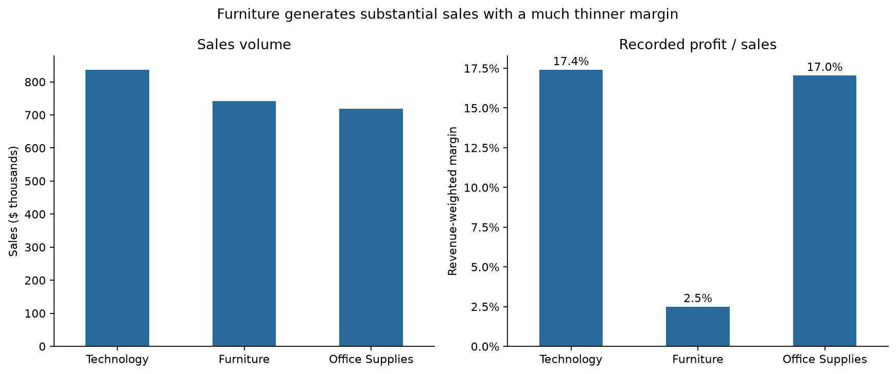
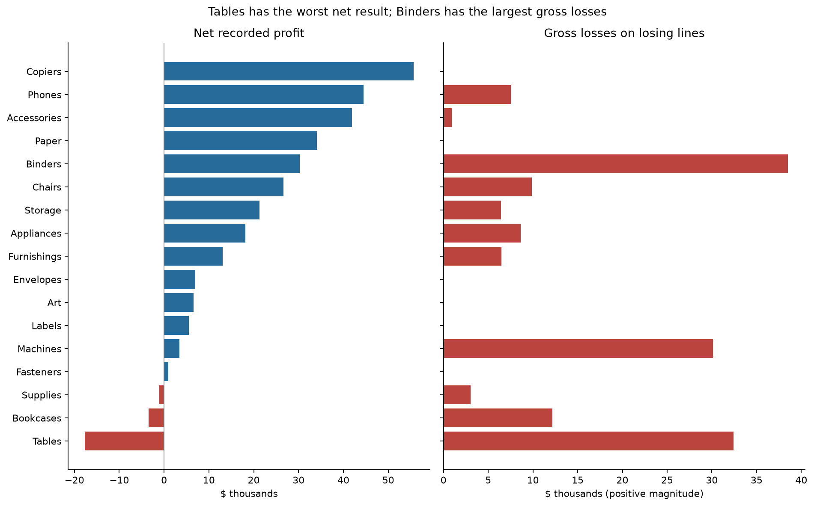
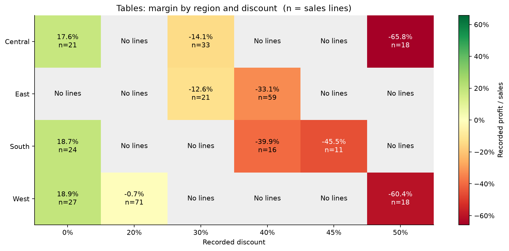
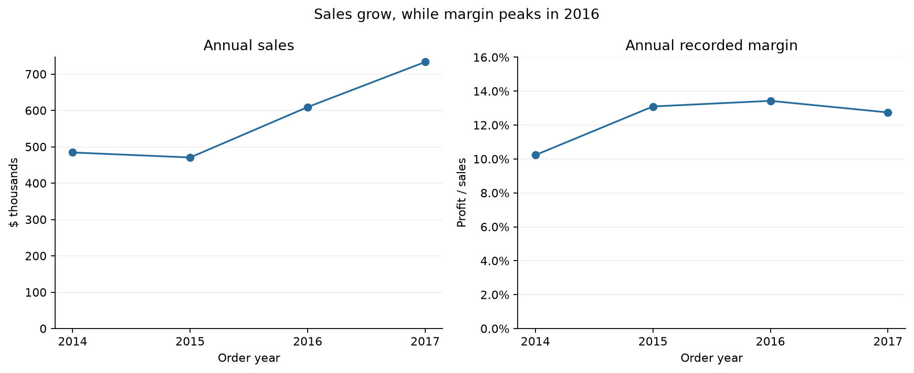

# E-commerce profitability analysis

**Where does strong sales volume hide weak or negative profitability?**

This project investigates the historical US Superstore sample with Python, pandas,
and Matplotlib. It moves from a portfolio overview to a focused review of Tables
by region, discount, and product, then proposes decisions the evidence can support.

The analysis is descriptive: it identifies transactions to investigate, rather
than promising recovered profit or estimating the effect of changing discounts.

## Findings

| Measure | Result |
| --- | ---: |
| Period, based on order date | January 2014–December 2017 |
| Sales lines / distinct orders | 9,994 / 5,009 |
| Sales | $2,297,201 |
| Recorded profit | $286,397 |
| Recorded profit / sales | 12.47% |
| Gross losses on losing lines | $156,131 across 1,871 lines |

**Furniture's sales conceal a thin margin.** Its 2.49% recorded margin is well
below Technology (17.40%) and Office Supplies (17.04%).



**Net profit and gross losses reveal different problems.** Tables has the worst
net result (−$17,725), but Binders accumulates more losses on losing lines
($38,510) while remaining net positive (+$30,222). Reviewing only net-negative
subcategories would miss that exposure.



**Tables deserves a targeted pricing and cost review.** Its 122 lines with
discounts of at least 40% record $64,774 in sales and −$27,296 in net profit.
The East has the largest Tables net loss (−$11,025 across 80 lines), but no
undiscounted Tables sales to use as a local baseline. Region and discount views
overlap; their losses must not be added together as independent opportunities.



**Growth does not guarantee sustained margin improvement.** Sales grew 51.4% and
profit 88.6% between the 2014 and 2017 endpoints. Annual margin peaked in 2016
and fell in 2017.



## Recommended next steps

1. Audit Tables transactions at deep discounts, especially East at 40% and the
   observed 50% cohorts in Central and West. Confirm cost and discount rules
   before testing a pricing change; track demand, units, and contribution margin.
2. Inspect the [Tables product review](reports/tables/tables_product_review.csv).
   It retains all 57 product ID/name pairs and flags the 37 with at least five
   lines. This is a review threshold, not statistical significance or a list of
   products to discontinue.
3. Extend the same investigation to Binders and Machines, where positive totals
   conceal substantial losses on individual lines.
4. Track margin and gross losses alongside sales using newer, reconciled data
   before making a current business decision.

These are proposals for investigation. The sample cannot tell us how demand would
respond to higher prices, whether products should be removed, or how much profit
an intervention would recover.

## Read or reproduce the analysis

Open [the executed notebook](notebooks/01_analysis.ipynb) on GitHub to see the audit,
calculations, supporting regional/segment/shipping tables, and interpretation.
No credentials or external data downloads are needed to run it.

Tested with **Python 3.12**. Direct dependencies are pinned in
[requirements.txt](requirements.txt); this does not lock every transitive dependency.

```bash
git clone https://github.com/enzoy-dev/Ecommerce-sales.git
cd Ecommerce-sales
python -m venv .venv
source .venv/bin/activate
python -m pip install -r requirements.txt
jupyter notebook notebooks/01_analysis.ipynb
```

On Windows, activate the environment with `.venv\Scripts\Activate.ps1` in PowerShell.
In Jupyter or VS Code, select this environment's Python kernel and run all cells
from a fresh kernel. The notebook accepts the repository root or `notebooks/` as
its working directory and regenerates `reports/`.

To execute without opening Jupyter, from the repository root:

```bash
jupyter nbconvert --to notebook --execute notebooks/01_analysis.ipynb --inplace --ExecutePreprocessor.timeout=180
```

The notebook validates schema, missing/duplicate records, numeric domains,
order-level consistency, date ordering, and reconciliation of grouped financial
totals. Regression checks protect the principal findings against silently changed
input. If the source changes, revisit those checks **and the written findings**.
GitHub Actions executes every cell from a fresh kernel and uploads the resulting
notebook, figures, and tables for review.

## Data and metric definitions

- **Input:** the bundled [Sample - Superstore.csv](data/Sample%20-%20Superstore.csv),
  containing 9,994 lines and 21 source columns. The raw CSV is preserved.
- **Provenance:** the original download URL and license were not documented with
  this file. Its upstream provenance and redistribution terms still need to be
  verified; no source or license is inferred here.
- **Sales line versus order:** a row is a line; an order is a distinct `Order ID`.
  One order can appear in multiple product groups, so group order counts overlap.
- **Margin:** `sum(Profit) / sum(Sales)`, not the average of individual line margins.
  `Profit` is the recorded field, whose cost coverage is undocumented; it is not
  established business-wide net income. Dollar notation follows the US sample
  convention; the CSV has no currency field.
- **Gross losses:** the positive magnitude of negative line profits. Positive-line
  profit minus gross losses equals net recorded profit. Gross losses are not an
  estimate of recoverable savings.
- **Product identity:** 32 product IDs have multiple names. Product rankings use
  ID/name pairs as provisional identifiers, pending a product-master review. Some
  names also contain garbled characters inherited from the source.
- **Shipping:** elapsed days are measured from order to shipment, once per order.
  Delivery dates, freight charges, and customer satisfaction are not available.

This historical sample lacks documented returns, marketing costs, inventory
constraints, and price-demand response. Product and customer mix, sparse cohorts,
and missing comparisons limit interpretation. Discount and regional differences
are associations, not causal estimates.

## Files

```text
data/Sample - Superstore.csv       Bundled source; unchanged
notebooks/01_analysis.ipynb        Executed analysis and validation
reports/figures/                   Four figures used above
reports/tables/                    Six CSV exports, including full product review
.github/workflows/analysis.yml     Automated notebook execution
requirements.txt                  Pinned direct dependencies
```

Author: **Enzo Sousa dos Santos**
